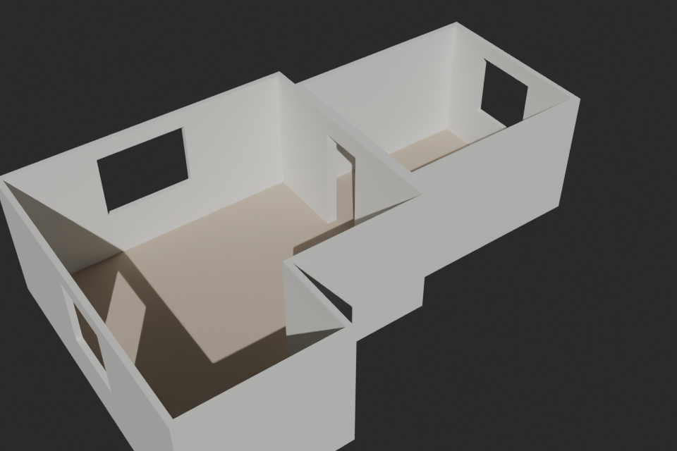
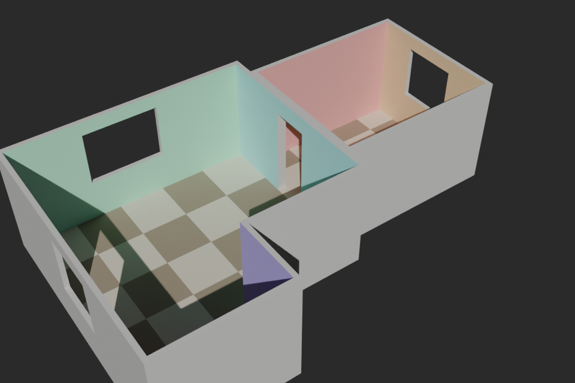

# Room Scanner

An Android app that captures the structure of a room with the phone camera and exports a clean
3D model for Blender. The design is in [`DESIGN.md`](DESIGN.md).



## Status

The app builds, and everything that can be tested without a phone is tested. **It has not been
run on a phone yet**, so expect rough edges in the camera screen on first use.

| Part | State |
|---|---|
| `core`: plan model, tap geometry, capture logic, solver, mesher, GLB export | Built, 51 unit tests, exports verified in Blender |
| App: projects, AR scan (corners, ceiling height, doors and windows), review, export and share | Built, not yet run on a device |
| Wall mode for corners hidden by furniture | In `core`, not in the app yet |
| Joining rooms at a shared doorway | In `core`, not in the app yet |
| Blender add-on for editable walls | Not started |

## Using the app

1. Create a project, then **Scan a room**.
2. Point the phone at the floor and move it slowly until a grid appears.
3. Aim the circle at a corner where a wall meets the floor and press **Mark corner**. Go round
   the room in order. Aim at the first corner again and press **Close room**.
4. Aim at the line where any wall meets the ceiling and press **Set height**.
5. Optionally mark doors and windows: one corner, then the opposite corner.
6. **Finish room**. Walk to the next room and repeat, or press **Done**.
7. In the project, open a room to check its wall lengths. Tap a wall to type in a length from a
   tape measure; the room is adjusted to match.
8. **Export GLB and send** opens the share sheet.

Things to know:

- The circle turns amber when a corner is too far away or seen at too shallow an angle to be
  accurate. Step closer.
- Rooms scanned in one visit to the scan screen keep their real positions relative to each
  other. Rooms from a later visit are placed beside the existing ones, not where they belong.
- A corner you cannot see cannot be marked yet (wall mode is not in the app).
- Metric only.

## Building

`core` needs only JDK 17 or newer. The app also needs the Android SDK (platform 35, build-tools
35.0.0), found through `ANDROID_HOME` or a `local.properties` file with `sdk.dir=...`. Opening
this folder in Android Studio sets that up.

```
./gradlew :core:test                 # unit tests
./gradlew :app:assembleDebug         # app/build/outputs/apk/debug/app-debug.apk
./gradlew :app:installDebug          # build and install on a connected phone
```

The phone needs Google Play Services for AR (ARCore).

## Plan to GLB without a phone

```
./gradlew :core:run --args="../samples/two-rooms.json -o ../out/flat.glb"
```

Then in Blender: File > Import > glTF 2.0, and pick `out/flat.glb`. It arrives upright, at 1:1
scale in metres, with one named object per wall, floor and ceiling under a parent per room.

Each object has its own material, so any surface can be recoloured without touching the others.
Solid walls have two material slots: the room-side face, and `_Body` for the rest of the slab.
UVs are at true scale (one unit per metre), so a tiling texture comes in at the right size.



Options: `--mode shell` for interior surfaces only, `--thickness 0.15`, `--obj` to also write
an OBJ. Plan files are JSON; `samples/two-rooms.json` shows the format.

To check an export against a real Blender without opening it:

```
pip install bpy
python3 tools/blender_check.py out/flat.glb --solid --render out/preview.png --demo
```

## Layout

```
core/                 Pure Kotlin, no Android dependencies
  model/              Project, Room, Wall, Opening
  geometry/           vectors, matrices, polygons, triangulation
  capture/            tap geometry, the tap-by-tap capture of a room, AR guide lines, projection
  solve/              corner clean-up, measured lengths, joining rooms at a doorway
  mesh/               plan to triangles
  export/             GLB, OBJ, plan JSON
  cli/                the plan-to-GLB tool
app/                  The Android app
  ar/                 ARCore session and camera image
  ui/                 screens: projects, project, room review, scan
  data/               project files and export
samples/              example plan
tools/blender_check.py  imports a GLB into Blender and verifies it
```

The app is deliberately thin. The scan screen feeds the camera's line of sight into
`core`'s `RoomCapture` and draws the lines it returns, so the scan logic is covered by unit
tests even though the camera screen is not.

## Known limits

- Every room gets its own walls. Where two rooms share a wall you get two leaves back to back
  rather than one body (see DESIGN.md section 9).
- Floors and ceilings are flat surfaces, not slabs.
- Flat ceilings, straight walls and rectangular openings only.
- The accuracy figures in the design are estimates. The solver is tested against simulated
  scans, not real ones.
